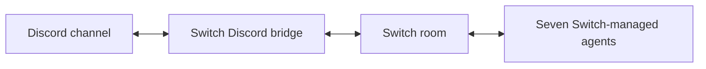

# Debate Arena

**Make better team decisions in Discord.** Bring a question and your constraints. Seven AI agents research two options, challenge each other's reasoning, and recommend a path. Your team can ask for more evidence and makes the final call by voting.

[Try the preview](#try-the-preview) · [Demo video](#demo-video) · [Run in Discord](#run-in-discord) · [Start a decision](#start-a-decision)

We built Debate Arena for the Flip the Switch Hackathon after our team kept going in circles about what to build. We wanted to see what each idea had going for it, which assumptions needed checking, and what would make us change our minds. [Read the build story on Medium.](https://medium.com/@pranjoy822/we-argued-too-much-so-we-built-an-ai-agent-to-argue-for-us-74aa6921a326)

## Demo video

**YouTube walkthrough coming soon.** Follow a decision from the first Discord message through agent handoffs, a recommendation, and the human vote.

<!-- When the video is published, replace the placeholder above with a [Watch the demo on YouTube] link to the video. -->

## Try the preview

The interactive preview runs in your browser using scripted examples. You can compare options, try **More info**, and see how the final report is laid out. It requires no Discord account, server, or model credentials.

```sh
git clone https://github.com/PhantomX-13/Debate-Arena.git
cd Debate-Arena
```

You can also use **Code → Download ZIP** and extract the files. Open [`feedback-preview.html`](feedback-preview.html) from the downloaded folder in your browser. Pick a mode, then step through a sample decision.

## What you can decide

| Mode | Example question | What the agents compare |
| --- | --- | --- |
| Learning | Should I learn Rust now or deepen my Python skills first? | Fit with your goal, learning curve, and time to a first project |
| Project | Should I build a budget tracker or a study planner for my portfolio? | Value, fit with your skills, and scope you can finish |
| Hackathon | Which prototype can our team build and demo this weekend? | Execution, originality, impact, and the event's judging criteria |
| Research | Which research direction can I investigate with the data I have? | Evidence of a gap, novelty, available resources, and feasibility |

[See the scoring criteria for each mode.](rubrics/rubrics.yaml)

## How it works



Switch connects the Discord channel to a room and routes replies and named handoffs. Each agent has its own instructions and receives the relevant decision context. All seven roles in the tested setup use the same agent provider, Codex.

| Agent | Responsibility |
| --- | --- |
| Moderator | Collects your context, runs the discussion, opens voting, and publishes the result. |
| Scout | Researches the options and brings back sources. |
| Advocate A | Makes the case for Option A and responds to objections. |
| Advocate B | Makes the case for Option B and responds to objections. |
| Coach | Checks what each option requires and whether it fits your time and experience. |
| Fact-Checker | Checks whether cited sources support the claims and flags gaps. |
| Judge | Scores both options with the mode's rubric and explains its recommendation and uncertainty. |

## Run in Discord

You need a machine running Switch Console, a working Codex sign-in on that machine, and a Discord server and text channel you can administer or have an admin connect for you. Teammates interact in Discord once the room is ready.

1. Download [Switch Console](https://github.com/sandbox-quantum/switch/releases/latest), start a local Switch server, and open **Settings → Agent providers → Codex**. Install or detect the provider, connect it to Switch if prompted, and sign in on the machine running the agents. [Switch setup guide.](https://www.switchagents.ai/blog-posts/switch-getting-started)
2. Connect your Discord server as a messaging app in Switch Console. Confirm that your target Discord text channel appears as a bridged room.
3. Under **Templates → Import template**, select [`debate-arena.template.yaml`](switch/templates/debate-arena.template.yaml) from your downloaded copy. Use the template to create the seven agents on **This computer**.
4. Open **Agent settings → Add to room** for each agent and select the bridged Discord room. Check the room's **Configuration → Participants** for all seven agents.
5. Under **Who can talk to your agent**, set the Moderator's **Custom rules** to allow your teammates and **My agents** in that specific room. Set the six specialists to **Me and my agents** so the Moderator can hand off work.
6. Ask each teammate to select **@debate-moderator** from Discord's mention list and send `DA-ACCESS`. A reply of `DA-ACCESS-OK` confirms access without starting a decision.

If the reply never arrives, check that the Moderator is in the bridged room and that the sender is allowed to address it there. If the reply reports a provider error, check the sign-in on the agent's execution machine. The [verification log](docs/RESULTS.md) includes a two-agent handoff test for checking the bridge and agent routing before trying a full decision.

The repo also includes an OpenCode template for exploring other models. The live Discord tests used Codex. See the [provider guide](docs/PROVIDERS.md) for local model requirements and checks for other providers.

## Start a decision

Select the Moderator from Discord's mention list and send a message like this:

```text
@debate-moderator LEARNING

Should I start Rust or deepen my Python backend skills first?
I want to prepare for a backend internship in 10 weeks. I have one hour
per day, know basic Python and Git, and have built a small Flask API.
I’m currently learning Python and have a laptop but no budget for courses.
```

Include your mode, question, goal, time per day, deadline if you have one, experience, and constraints. For **Learning**, say what you currently study. For **Project**, include any idea you already have. The workflow runs one active decision per room.

1. **Share your perspective.** The Moderator confirms two options. Anyone can mention it with an opinion, reason, or source. When the group is ready, the person who started the decision mentions it and says **Start**.
2. **Read the recommendation.** The agents debate both options and check the evidence. The Moderator shares the Judge's recommendation and a detailed review of the arguments, sources, and uncertainties.
3. **Vote when the ballot opens.** Mention the Moderator and say **Option A**, **Option B**, or **More info**. Each person's latest valid vote counts once per round. The person who started the decision mentions the Moderator and says **Close** to end voting.
4. **Ask for more evidence if needed.** If neither option wins a majority in the first ballot, the Moderator asks a focused follow-up question. The agents revisit the same two options and open one more ballot. If neither wins a majority then, the decision stays pending and the report explains what evidence is still missing.

The final Markdown report records the recommendation, sources, uncertainties, and human vote. The Moderator saves it under `reports/` in its configured working directory when available and shares it in the room. [See the report template.](reports/TEMPLATE.md)

## Project status

Live Discord tests exercised all four modes, named agent handoffs, teammate voting, and report delivery. The team also observed both outcomes after **More info**: a choice after the second ballot and a decision left pending. Some runs required retries or manual steps. [See what was verified and what remains open.](docs/RESULTS.md)

## Repository guide

| Path | What's inside |
| --- | --- |
| [`switch/templates/`](switch/templates/) | Switch templates for the seven agents and their instructions |
| [`rubrics/`](rubrics/) | Scoring criteria for each decision mode |
| [`reports/`](reports/) | The Markdown report template |
| [`tools/`](tools/) | Vote tallying, URL checks, and a standalone model connectivity check |
| [`tests/EVAL.md`](tests/EVAL.md) | Evaluation scenarios and expected behavior |
| [`docs/DEMO.md`](docs/DEMO.md) | Demo walkthrough |

Run the local checks from the repository root with Python 3. The tests and utilities use the Python standard library.

```sh
python3 -m unittest discover -s tests
```

To check whether URLs in a saved report are reachable, run `python3 tools/verify_sources.py --file path/to/report.md` with your report path. The Fact-Checker evaluates whether a source supports a claim.

## Feedback

If you try Debate Arena, share your decision mode, what you expected, and what happened in a [GitHub issue](https://github.com/PhantomX-13/Debate-Arena/issues).

This repository currently has no license file.
